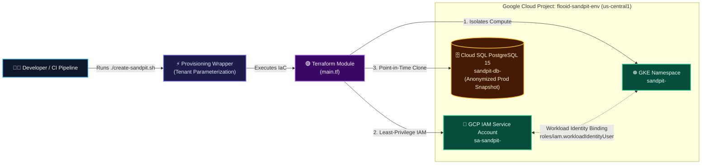
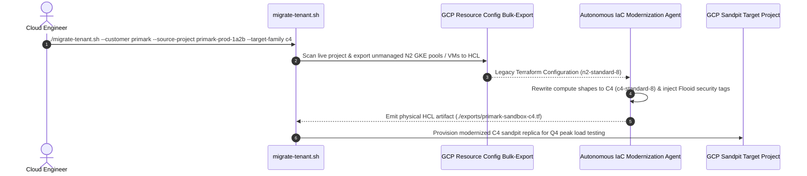

<div align="center">

# 🏗️ Flooid GCP Ephemeral Sandpit Provisioner
### Autonomous Multi-Tenant Retail Sandbox Cloning & Legacy IaC Modernization (`N2` → `C4`)

[](https://cloud.google.com/)
[](./main.tf)
[](./main.tf)
[](./main.tf)

**[Executive Overview](#-executive-overview)** • **[Architecture](#-architecture--autonomous-migration-flow)** • **[Repository Contents](#-repository-contents)** • **[Live Demo Playbook](#-live-demo-playbook)** • **[Executive Value Pillars](#-executive-value-pillars)**

</div>

---

## 📌 Executive Overview

**Flooid GCP Sandpit Provisioner** (`flooid-gcp-sandpit-provisioner`) demonstrates **Track 3: Ephemeral "Sandpit" Replicas of Product Environments** for high-concurrency retail Point-of-Sale (POS) platforms.

It enables engineering teams and autonomous AI agents to:
1. **Spin up isolated, full-stack tenant sandpits on demand** (`GKE Namespace` + `Workload Identity IAM` + anonymized `Cloud SQL PostgreSQL` snapshot clone) in minutes without ticketing queues.
2. **Automatically codify & modernize legacy tenant environments** by exporting live GCP resources (`gcloud beta resource-config bulk-export`) into Terraform HCL and upgrading legacy `N2` compute footprints to next-generation **`C4` (`c4-standard-8`)** instances ahead of Q4 / Black Friday peak testing.

---

## 🏛️ Architecture & Autonomous Migration Flow

### 1. On-Demand Ephemeral Sandpit Provisioning (`create-sandpit.sh` + `main.tf`)



### 2. AI-Driven Legacy Environment Codification & `N2` → `C4` Upgrade (`migrate-tenant.sh`)



---

## 📦 Repository Contents

| File / Directory | Purpose | Key Highlights |
| :--- | :--- | :--- |
| [`main.tf`](./main.tf) | **Production Terraform Module** | Provisions isolated `kubernetes_namespace`, least-privilege `google_service_account`, Workload Identity IAM bindings, and a `google_sql_database_instance` cloned from an anonymized production template. |
| [`create-sandpit.sh`](./create-sandpit.sh) | **Demo 1: Instant Sandpit CLI** | Interactive terminal simulation demonstrating developer self-service provisioning of tenant sandpits with readiness verification. |
| [`migrate-tenant.sh`](./migrate-tenant.sh) | **Demo 2: Legacy-to-C4 IaC Translator** | Simulates scanning an existing customer project, exporting live resources to Terraform, upgrading `n2-standard-8` → `c4-standard-8`, and writing the modernized HCL to [`exports/`](./exports). |
| [`exports/`](./exports) | **Generated Terraform Artifacts** | Output directory containing physical `.tf` files generated by `migrate-tenant.sh` (e.g., `primark-sandbox-c4.tf`). |

---

## 🚀 Live Demo Playbook

### Demo 1: On-Demand Component Replicas
Spin up an isolated, ephemeral retail tenant environment in seconds:

```bash
cd ~/flooid-demo/sandpit
./create-sandpit.sh --tenant retail-client-a
```

**What happens during execution:**
- Authenticates target project `flooid-sandpit-env` and initializes Terraform backend.
- Creates isolated GKE namespace `sandpit-retail-client-a` and binds GCP Service Account via **Workload Identity**.
- Clones anonymized PostgreSQL 15 instance `flooid-prod-template-anonymized-v4` into `sandpit-db-retail-client-a`.
- Outputs the live sandbox endpoint (`https://retail-client-a.sandpit.flooid.internal`) and teardown command.

---

### Demo 2: Codifying & Upgrading Legacy Environments (`N2` → `C4`)

> [!TIP]
> **Sample AI Prompt for the Developer:**
> *"I need to run Q4 peak load tests for Primark. Please scan their existing `primark-prod-1a2b` project, extract the current Terraform configuration, and generate a new Sandpit replica. As you write the new Terraform, upgrade their legacy N2 GKE nodes and VMs to the new C4 instance family for better performance. Make sure to apply all our standard Flooid sandpit security rules."*

Run the autonomous migration and instance-modernization simulation:

```bash
cd ~/flooid-demo/sandpit
./migrate-tenant.sh --customer primark --source-project primark-prod-1a2b --target-family c4
```

**Four-Stage Execution Pipeline:**
1. **Live Project Discovery**: Scans `primark-prod-1a2b` and detects legacy `n2-standard-8` GKE node pools, POS connector VMs, and Cloud SQL PostgreSQL 14 instances.
2. **IaC Codification**: Uses `gcloud beta resource-config bulk-export` to reverse-engineer unmanaged infrastructure into declarative Terraform HCL.
3. **Autonomous AI Translation**: Rewrites machine types from `n2-standard-8` → `c4-standard-8`, injects `hyperdisk-balanced` boot disks, enforces private-node isolation, and saves the physical file to `./exports/primark-sandbox-c4.tf`.
4. **Sandpit Deployment**: Applies the modernized Terraform plan into the isolated sandpit environment for Q4 peak benchmarking.

---

## 💡 Executive Value Pillars

| Pillar | Business & Engineering Impact |
| :--- | :--- |
| **⚡ Speed to Market** | Developers and QA engineers spin up deterministic, full-stack retail replicas in minutes without waiting on centralized Ops tickets. |
| **💰 FinOps & TTL Governance** | Sandpits run on right-sized tiers (`db-custom-2-7680`) with automated `ttl = 12h` expiration labels to eliminate zombie cloud spend. |
| **🛡️ Zero-Trust Tenant Isolation** | GKE Workload Identity binds Kubernetes service accounts directly to scoped GCP IAM principals—preventing cross-tenant access or secret leakage. |
| **🚀 Frictionless Gen-4 Modernization** | Automated bulk-export + AI translation removes the manual toil of migrating legacy `N1`/`N2` estates to high-performance `C4` compute. |
