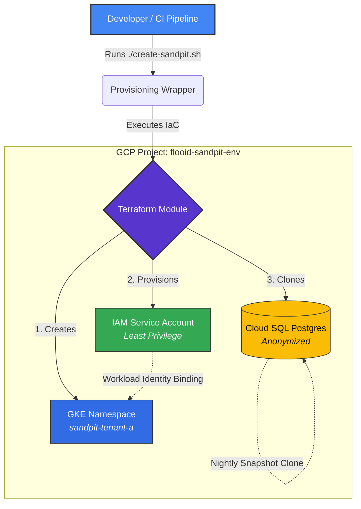

# 🏗️ Flooid Demo: Ephemeral "Sandpit" Replicas


**Track 3: Ephemeral "Sandpit" Replicas of Product Environments**

This directory contains a demonstration of spinning up full-stack, component-level sandpit replicas of production retail environments on demand, ensuring strict tenant isolation and least-privilege access.

---

## 🏛️ Architecture Flow

The sandpit provisioning automates the creation of a secure, isolated environment cloned directly from anonymized production templates.



---

## 📦 What's Included

*   **`main.tf`**: Real Terraform Infrastructure-as-Code (IaC) defining the required resources for a sandpit replica.
    *   **GKE Namespaces:** For workload isolation and network policy boundaries.
    *   **IAM Service Accounts & Workload Identity:** Mapping GKE service accounts to GCP IAM for least-privilege access.
    *   **Cloud SQL Database:** Configured to clone from an anonymized production snapshot template.
*   **`create-sandpit.sh`**: A terminal simulation script designed for live demonstrations to show the developer experience (DX) of provisioning these environments instantly.

---

## 🚀 How to Run the Demo

During the meeting, navigate to this directory and run the simulation script:

```bash
cd ~/flooid-demo/sandpit
./create-sandpit.sh --tenant retail-client-a
```

---

## 💡 Key Discussion Points for the Meeting

1.  **Speed to Market:** Developers can spin up isolated replicas without waiting on centralized IT/Ops pipelines or ticketing systems.
2.  **Cost Control:** Sandpits use cost-effective database tiers and can be tagged for automated TTLs (Time-To-Live) for cleanup (e.g., auto-destroy after 12 hours to prevent resource bloat).
3.  **Security & Strict Isolation:** Showcases how Workload Identity bridges the Kubernetes namespace directly to GCP IAM, strictly preventing cross-tenant data access or lateral movement.
